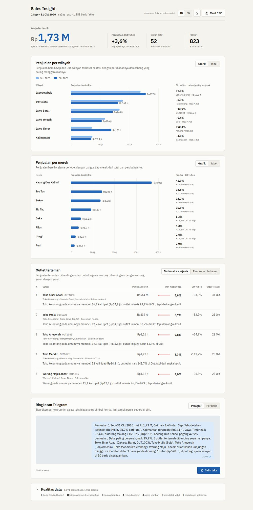

# Sales Insight

A small web app for a sales export: net sales by region and brand, the 5 weakest outlets, and a one-paragraph
summary a sales manager can paste into Telegram. Indonesian and English, light and dark.

Live: https://dk-sales-insight.pages.dev



## Run it

Needs Node.js 20.19 or newer.

```bash
git clone https://github.com/Zetakai/dk-sales-insight.git
cd dk-sales-insight
npm install
npm run dev
```

Open http://localhost:5173. It opens on `data/sales.csv`, the sample export from the brief; put another export with
the same columns in its place to open on that. **Muat CSV / Load CSV** (or dropping a file on the page) loads any
export without a restart; the header says which file is shown. A loaded file is read in the browser and never
uploaded anywhere.

```bash
npm test            # 70 tests: CSV parsing, cleaning, metrics, the region filter, the summary
npm run typecheck
npm run build       # static site in dist/
```

## What it shows

| Section | How it is worked out |
|---|---|
| Wilayah filter | All regions, or one: every section below then covers that region only, and the region chart becomes its branches |
| Net sales | After discounts and returns, with the change from the first month to the last |
| By region | Both months side by side, and the branch that moved the region most (in rupiah) |
| By brand | Total, share of all sales, and the change |
| 5 weakest outlets | Lowest net sales **compared with the median outlet of the same type**. A warung always sells less than a grosir, so raw totals would only ever flag small shops; against its own kind, an outlet is weak for what it is. Each row says why in one line. A second view lists the 5 biggest drops between the months. |
| Telegram summary | One plain-text paragraph (no Markdown symbols, which Telegram would show literally), under 900 characters, in the page language. **Per baris / Line by line** shows the same text broken into lines with the outlets numbered, easier to read on a phone. **Salin teks / Copy** puts exactly the shown text on the clipboard. |
| Data quality | Everything cleaning changed, so no number moves without a reason |

## Cleaning

Real exports are messy, so the app fixes what it safely can and lists every fix under Data quality:

- **Exact duplicate lines** (all 15 columns equal): the first is kept.
- **Region spellings** (`Jabar`, `JAWA BARAT`): mapped to the most common spelling of that region.
- **Extra spaces in outlet names**: trimmed.
- **Returns** (`RTR…` invoices, negative quantity): kept as negative sales, so they reduce net sales.
- **Two outlet ids with the same name**: kept apart (grouped by id), and shown with the branch.
- **Lines with no salesman**: counted, and listed.
- **Bad rows** (empty field, a number like `198.000`, a date that is not YYYY-MM-DD): skipped and listed with the line
  number. `198.000` is refused rather than read as 198, because in an Indonesian export it means 198 thousand.

Comma, semicolon (Excel in an Indonesian locale) and tab separated files all load, with headers in any case.

## How it is built

React + TypeScript on Vite, with no chart or UI library: the charts are hand-drawn SVG. The app runs entirely in the
browser, so the data never leaves the machine.

```
src/lib/        data layer, no React: csv.ts → clean.ts → metrics.ts → summary.ts (types.ts is the contract)
src/ui/         components; every visible string is in i18n.ts
docs/SPEC.md    the exact definitions of every number
data/sales.csv  the sample export from the brief (1,891 lines, Sep–Oct 2026)
data/demo.csv   synthetic data (scripts/make-demo.mjs) with the same columns and the same kinds of problems
```

**Two independent implementations agree on every number.** `scripts/reference_insights.py` computes the same
insights in plain Python from the spec, and the tests compare the app's result with it field by field, on both the
sample from the brief, the synthetic demo, and one region of the demo.

## How I built it with Claude Code

I directed it; Claude Code did the building and the testing. A main Claude session acted as the orchestrator:

1. **Spec and contract first.** Before any code, it wrote `docs/SPEC.md` (every number defined exactly),
   `src/lib/types.ts` (the contract between data and UI) and `scripts/reference_insights.py`, which computes the
   expected result independently in Python.
2. **Two agents in parallel, split by folder.** A data agent built `src/lib` with its tests against the reference. A
   UI agent built `src/ui` with two Claude skills: `interface-design` (hierarchy, surface and type tokens, empty and
   error states) and `dataviz` (chart form, mark specs, and its palette validator for contrast and colour-blind
   safety).
3. **A third agent reviewed** the merged code without editing it. It found 10 issues, among them a race between two
   uploads, semicolon-separated Excel exports and error messages that stayed English; the main Claude session fixed
   all of them.
4. **Claude tested its own work** in a real browser with Playwright: desktop, laptop, phone and 2K widths, light and
   dark, both languages, and Load CSV with crafted files (semicolons, a missing column, bad rows, an `.xlsx`).
5. **I reviewed it visually and made the product calls:** a public repo with the brief's sample data, a line-by-line
   option for the Telegram summary, a full-width dashboard grid instead of a centred column, a summary card that stays
   in place, and the region filter.
